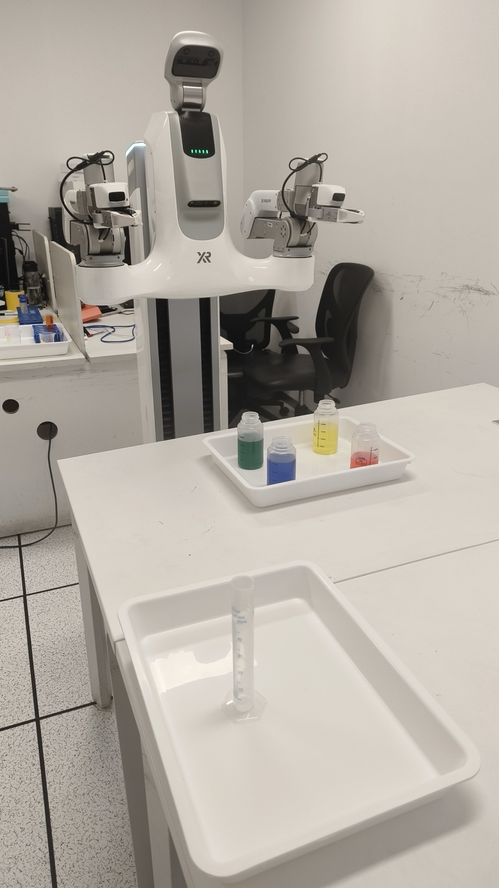

# 轮式双臂大作业：取瓶量液

## 1. 任务概述

平台为量子一号 Pro（Quantum X1 Pro）轮式双臂机器人。

场景是一张两侧各放一个托盘的大桌子：第一个托盘里摆放 4 个不同颜色的瓶子（瓶中分别盛不同颜色的液体），第二个托盘里立放量筒。机器人根据指令完成**取瓶量液**任务：拿起指令指定颜色的瓶子，移动到第二个托盘的位置，把瓶中液体倒入量筒、量取指令指定的体积。共进行 3 次测试，取平均成绩。

**技术路线完全开放**：VLA、WAM（世界-动作模型）、agent 操控、传统规划控制，或直接调用外部大模型 API（如 GPT-6）驱动，任何方案都可以，最终以测试表现和报告评定。**（说明：如果选择智能体方案，自变量机器人将提供具身模型api调用，外部大模型将自费）**

## 2. 场地与器材

（尺寸与器材规格以现场实测和赛前公布为准）

- 大桌一张，两侧各放一个托盘；
- 托盘 A：4 个不同颜色的瓶子（绿、蓝、黄、红），瓶内液体颜色与瓶身颜色对应；
- 托盘 B：量筒一个，容量以现场器材为准；
- 液体一律为水加食用色素，安全无害；
- 每次测试前现场公布指令：**颜色 + 目标体积**（如"蓝色，40 mL"）；所有组使用同一组指令序列，保证公平。



## 3. 提供的资源

### 3.1 wall-x/：开源全链路代码（子模块）

选做本赛道的组拉取本赛道的子模块即可，不必下载其他赛道的内容：

```bash
git submodule update --init wall-x
```

wall-x（Apache-2.0 协议）是量子一号配套的开源软件栈，覆盖数据采集、遥操作、VLA 模型后训练与微调（Wall-OSS）、真机部署、SDK（控制/感知/导航）、建图导航和仿真评测的完整链路，可整体使用，也可只用其中一部分。

### 3.2 开发者文档（在线）

官方开发者文档详细介绍数据采集、VLA 模型后训练、部署、SDK、建图导航等内容：

https://x2robot.com/docs/quantax1pro/v1/model-development/wall-oss/model-introduction

文档包含模型介绍与三种开发路径（直接验证预训练模型、用自有数据微调、适配第三方模型）、快速开始、数据准备、训练与评估、推理与真机运行、SDK 接口、数据采集与遥操作指南、建图导航指南和仿真（LIBERO）等章节。

### 3.3 产品说明手册

本文件夹内的《量子1号Pro_产品说明手册.pdf》，介绍机器人硬件、规格和使用方式。

### 3.4 硬件与场地

- 机器人和场地由课程组统一管理；电池与充电器随机器人一起存放、借用，无需自备。
- 真机使用安排：第 12 周起可进行最终测试；此前的各周末可预约助教进行真机实验。

## 4. 任务要求

1. **完成任务**：按第 5 节完成 3 次取瓶量液测试。
2. **技术方案自选**：从 wall-x 全链路中取用需要的部分，或采用任何其他方案；不限制模型、框架和控制方式。
3. 报告要求见第 6 节。

## 5. 测试与计分（100 分）

### 5.1 测试流程

- 每组 3 次测试，每次测试前现场公布指令（颜色 + 目标体积）；
- 单次测试不限总时长，但机器人卡死在原地超过 60 s（视现场调整），裁判直接判定该次失败并终止测试；已完成部分仍按颜色、体积和过程分项计分；
- 两名裁判独立记录，成绩当天公布；
- **最终成绩 = 3 次单次测试得分的平均值 + 实验报告分（20 分）**，满分 100 分。

### 5.2 计分方法（单次测试 80 分）

| 项目 | 分值 | 计算方法 |
| --- | ---: | --- |
| 颜色正确 | 20 | 每次量筒中液体颜色与指令一致得 20 分，取错颜色记 0 分 |
| 体积准确度 | 30 | 每次按量筒读数与目标体积的相对误差分档给分（见下） |
| 过程分 | 30 | 按步骤完成度给分：正确抓起瓶子 7 分、移动到第二托盘 7 分、完成倒液入量筒 9 分、收尾归位 7 分；未完成全部任务也可按完成步骤得分 |

单次体积分（30 分）按**相对误差**（|ΔV| / 目标体积）分档：

| 相对误差 | ≤5% | 5%～10% | 10%～20% | 20%～30% | >30% |
| --- | --- | --- | --- | --- | --- |
| 得分 | 30 | 24 | 18 | 8 | 0 |

- **只以量筒内的液体计分**：过程中洒出多少液体不扣分，也不影响任何判分项；体积按测试结束后裁判读取的量筒刻度计算（凹液面下缘）。
- 取错颜色时该次仍可计过程分，体积分记 0。

### 5.3 记录与公布

每次测试记录指令、量筒读数、各步骤完成情况和失败原因（卡死、抓取失败、洒漏、错误颜色等）；成绩当天公布，有异议当天向裁判组提出核对。

## 6. 提交物与报告

- **代码**：完成任务所用的全部脚本和环境文件，附一键运行说明。
- **模型/配置**：使用的模型权重（如无可不附）及全部配置。
- **数据**：方案中如包含数据采集（遥操作示教、微调数据集等），采集的数据整理后一并提交。
- **报告**：技术路线与选型理由、系统设计与实现、测试结果、成功与失败原因分析、后续改进方向。
- 数据必须真实：虚报成绩按学术诚信问题处理。
- **提交方式**：以上材料打包后，在 Canvas 上以小组形式提交。

## 7. 安全规范

- 底盘移动和机械臂动作时保持周围人员安全距离，并有专人负责急停。
- 液体一律使用水和食用色素，不使用任何真实试剂。
- 倒液过程中出现异常立即停止；洒出的液体及时清理，避免进入机器人电子部件。
- 机器人异响、发热或电量过低时停止使用。

疑问通过课程群或助教邮箱联系课程组。
